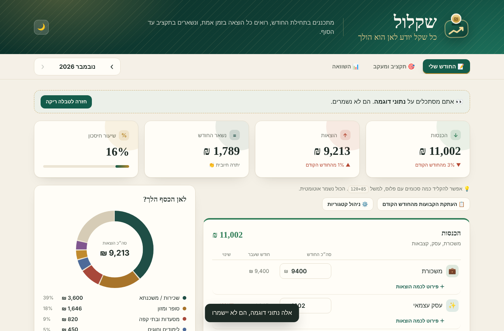
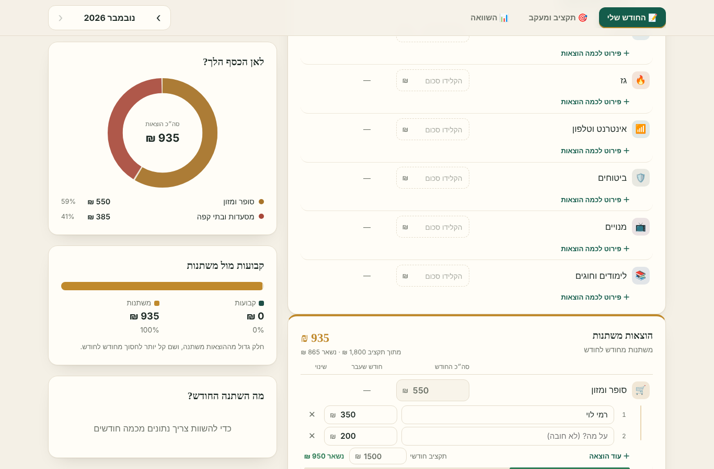
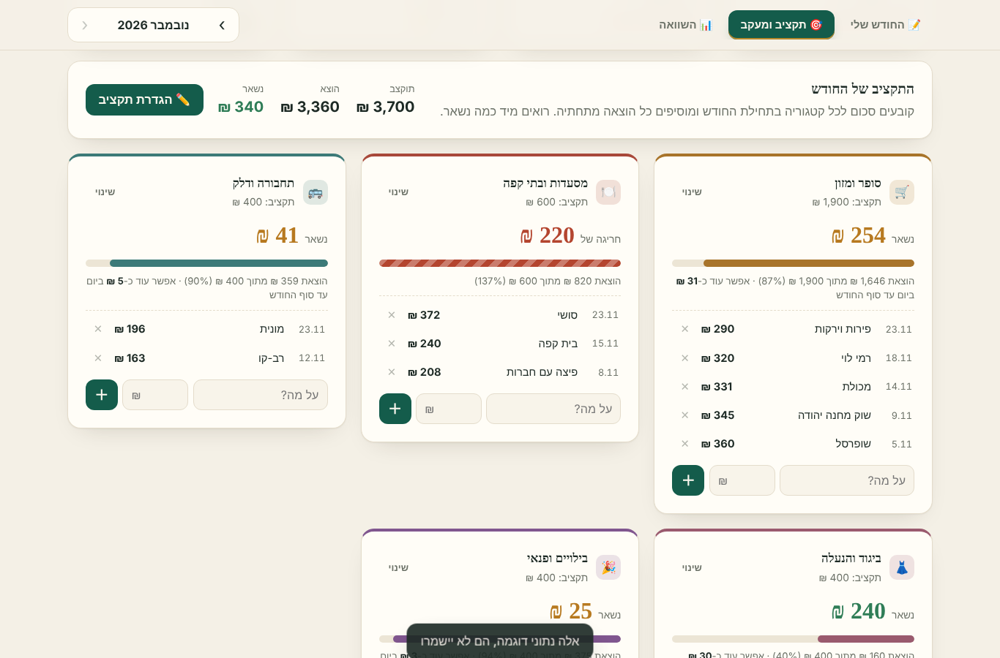
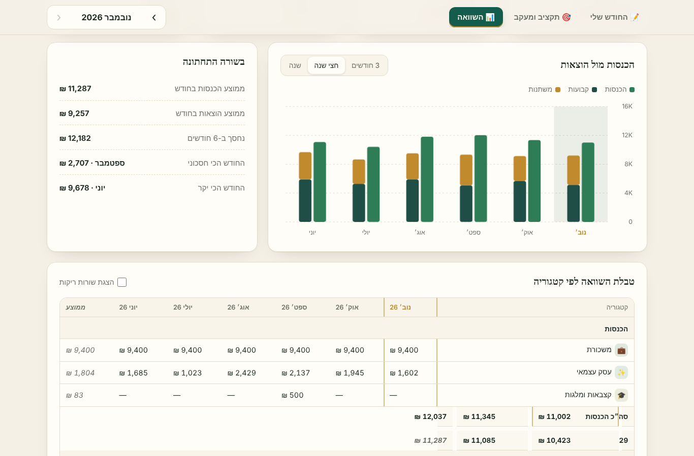
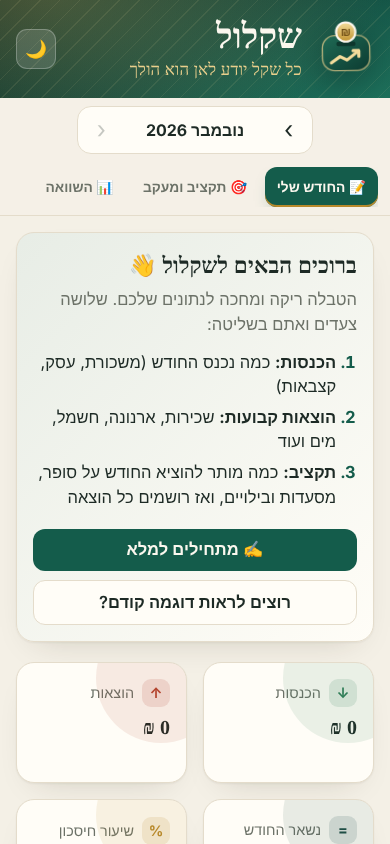

<div align="center">


# שקלול · Shiklul

### כל שקל יודע לאן הוא הולך
*Every shekel knows where it's going.*

A personal monthly budget planner in Hebrew. Enter your income and your fixed and variable expenses, set a budget per category at the start of the month, log every expense under it, and compare month by month.




</div>

## ✨ What it does

### 📝 My month: an organized monthly sheet
Three clear sections: **income**, **fixed expenses** (rent, arnona, electricity, water, gas, internet, insurance…) and **variable expenses** (groceries, restaurants, transport, clothing, going out…).

- Type an amount per category, or several at once: `120+85` → 205
- **Separate entries under a category:** went to the supermarket four times? Click "＋ פירוט לכמה הוצאות" and log each trip on its own line (with an optional note). The category total updates automatically, and Enter adds the next line.
- **Monthly budget per variable category, right in the sheet:** see "נשאר ₪550" or "חריגה" with a progress bar, plus the total budget and what's left for the whole section



- Every row shows last month's amount and the % change
- **Copy fixed expenses from last month** with one click
- An **"other"** line in every section, plus **"＋ הוספת קטגוריה משלך"** at the bottom of each section: type a name (a vet, a haircut, a daycare…) and it is added on the spot. Categories can also be removed, because every household is different.
- Side panel: where the money went (donut chart), fixed vs. variable split, and the biggest changes compared with your recent average

### 🎯 Budget & tracking: envelopes


Set a budget per category at the start of the month (for example ₪500 for going out). Each category becomes an **envelope**:

- Add each expense under it (description and amount)
- See **how much is left** right away, with a progress bar that turns amber at 80% and red when over budget
- *"You can spend about ₪31 a day until the end of the month"*: a daily allowance for the current month
- The monthly sheet stays in sync automatically

Plus **savings goals** with progress rings and a confetti 🎉 when you reach one.

### 📊 Compare months


- Income vs. fixed + variable expenses for 3, 6 or 12 months
- A **category × month table** with subtotals, averages, heat shading and ▲▼ flags for months that are more than 15% off the average
- Bottom-line facts: average income and spending, total saved, the cheapest and the most expensive month

### 📲 Installable app (PWA)
Shiklul installs like a native app on **phones and computers**, with its own icon and full-screen window, and it **works offline**:
- **iPhone (Safari):** Share ⬆︎ → "הוספה למסך הבית"
- **Android (Chrome):** ⋮ → "התקנת אפליקציה", or the in-app "📲 התקנת האפליקציה" button
- **Desktop (Chrome / Edge):** the install icon in the address bar

Built with a web app manifest, maskable icons, and a service worker (cache-first app shell, stale-while-revalidate fonts).

### And also
Dark mode · fully responsive · CSV export (opens in Excel with Hebrew) · JSON backup & restore · keyboard month navigation (← →) · all data stays private in your browser (`localStorage`).

<p align="center"></p>

## 🧱 Architecture

```
shiklul/
├── index.html            # markup, inline SVG logo, <dialog> forms
├── styles.css            # design tokens, light/dark themes, responsive layout
├── app.js                # UI controller: views, live editing, dialogs
├── utils.js              # pure logic: totals, months, averages, envelopes, CSV  ← unit-tested
├── store.js              # localStorage, schema validation + migrations, seeded demo data
├── charts.js             # dependency-free SVG donut and stacked bar charts
├── utils.test.js         # tests with the built-in Node test runner
├── manifest.webmanifest  # PWA: name, icons, colors, shortcuts
├── sw.js                 # service worker: offline support
└── *.png / favicon.svg   # app icons and screenshots
```

A deliberately flat layout: the whole app is a handful of ES modules served as-is, with no build step and no bundler.

**Design decisions**

- **One source of truth.** A category's monthly total is either typed directly or derived from its itemised expenses (`setItems` keeps them in sync). It is never both.
- **Live editing without losing focus.** Typing updates the totals, charts and comparisons in place, and saving is debounced.
- **Pure functions first.** All calculations live in `utils.js` with no DOM access, so they are easy to test.
- **Safe by default.** User text is escaped before rendering, and imported backups are validated, normalized and migrated from the older data format.
- **Accessible.** Native `<dialog>` elements, labelled inputs, keyboard-friendly sheet (Enter moves to the next field), `prefers-reduced-motion` support.

## 🚀 Getting started

```bash
git clone https://github.com/<your-username>/shiklul.git
cd shiklul
npm start          # or: python3 -m http.server
```

The app starts empty with a short 3-step welcome. To preview it with six months of sample data, click **"רוצים לראות דוגמה קודם?"**. Sample data is never saved.

```bash
npm test           # Node 18+, no npm install needed (zero dependencies)
```

## 🌐 Deploy to GitHub Pages

**Settings → Pages → Deploy from a branch → `main` / `root`**. A minute later the app is live at `https://<your-username>.github.io/shiklul/`.

---

<div align="center">Built by <b>Racheli Arzon</b> 💜</div>
